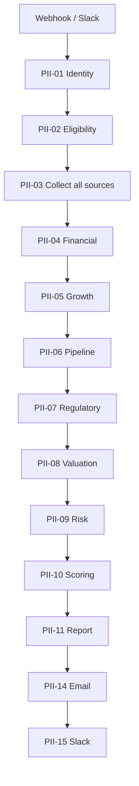
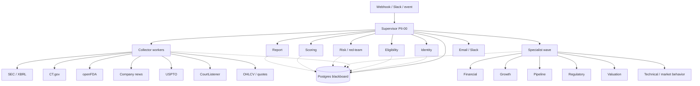

# Orchestrated multi-agent investigator

**Document status:** Implementation-ready architecture specification (local only; not deployed)  
**Companion to:** [`PHARMA_INVESTMENT_OPPORTUNITY_INVESTIGATOR.md`](../PHARMA_INVESTMENT_OPPORTUNITY_INVESTIGATOR.md) (product baseline)  
**Does not replace:** Phase 1 n8n workflows, [`docs/ENRICHMENT.md`](ENRICHMENT.md), or hosted deploy IDs in [`AGENTS.md`](../AGENTS.md)

This specification transforms the current **hardcoded sequential pipeline** into a **supervisor-orchestrated multi-agent system** while keeping PostgreSQL as the system of record and n8n as the initial runtime. It also fills a product gap: **technical / market-behavior analysis is specified but not implemented**, and must be a first-class specialist rather than a stub inside valuation.

---

## 1. Why this change

### 1.1 What the system is today

PII-00 is a parent workflow that **always** runs specialists in canvas order:

```text
webhook → identity → eligibility → collect →
  financial → growth → pipeline → regulatory → valuation → risk →
  scoring → report → email → Slack
```

That topology is a sequence, not an orchestrator:

| Symptom | Consequence |
|---|---|
| Analysts 04–08 are independent but run one after another | Full-case latency is the sum of specialists; a slow pipeline pass blocks valuation |
| PII-09 cannot start until 04–08 finish even when it only needs their **stored claims** | Artificial coupling through canvas edges instead of the database |
| `EVENT_REASSESSMENT` and `REFRESH` still imply a full chain | Product §17 (“run only required collectors and analysts”) is unimplemented |
| Coverage gaps are recorded as `INSUFFICIENT_EVIDENCE` and never re-planned | No supervisor reads those gaps and dispatches a fill-in collector |
| PII-03 collectors are themselves sequential | SEC, XBRL, CT.gov, FDA, news, USPTO, and CourtListener wait on each other |
| “Agent” specialists are deterministic Code nodes with no tools, memory, or LLM shell | Product §13 AI tasks (extraction, synthesis, red-team language) have no home |

The product already asked for a parent orchestrator plus specialized subworkflows (§6.1) and incremental reassessment (§17). Phase 1 delivered the specialists as a **fixed script**. This document is the control-plane redesign.

### 1.2 What “multi-agent” means here

An **agent** is a named specialist with a bounded objective, a versioned contract, an explicit tool allowlist, and write privileges limited to its domain. It is not a free-roaming chatbot.

An **orchestrator** (supervisor) plans a task graph from case mode, state, evidence coverage, and events; dispatches agents; joins results; and decides the next wave, human review, or completion. It owns case-state transitions. Specialists do not.

This definition is useful **before** any LLM is added. Phase 1 specialists are already domain agents with empty toolbelts. The missing piece is the supervisor, the task graph, and two new specialists (market-data collection and technical analysis). LLM shells are an optional later slice under the existing §13 controls.

### 1.3 Non-goals

- Brokerage, order routing, position sizing, or personalized buy/sell language (product §3.3, §22.14).
- Intraday or tick-level trading signals.
- Letting a technical setup override a failed identity, eligibility, cash/debt, or red-team gate.
- Replacing PostgreSQL as the case blackboard.
- A big-bang rewrite of hosted PII-00…PII-15 in one deploy.
- Scraping vendor charting UIs or bypassing licensed market-data terms.
- Treating LLM text as evidence.

---

## 2. Current vs target control plane

### 2.1 Current (sequenced)

```text
PII-00 canvas edges decide who runs.
Each Execute Sub-workflow node is a hardcoded next step.
Postgres stores results but does not schedule work.
```



### 2.2 Target (orchestrated)

```text
Supervisor writes a DAG into agent_tasks.
Ready tasks are dispatched (in parallel when independent).
Agents read/write the blackboard and return a result envelope.
Supervisor advances case state only after join + gate checks.
```



Hard sequential constraints that **remain**:

1. Identity before eligibility.
2. Eligibility `PASS` / `PASS_WITH_EXCEPTION` before collection.
3. Collection coverage gate before the specialist wave.
4. Specialist wave complete before red-team (PII-09 reads their claims).
5. Red-team complete before scoring.
6. Scoring complete before report publication gates.
7. Report before delivery.

Everything else is a DAG, not a canvas chain.

---

## 3. Architecture

### 3.1 Blackboard (shared memory)

PostgreSQL (`pii_research`) remains authoritative for case state, evidence, claims, scores, and reports. Agents never pass large payloads to each other through n8n item streams. They pass **IDs** (`case_id`, `task_id`, `evidence_id`) and read the rest from the database.

This is already how specialists work internally (Load Case / Load Evidence / Load Claims). The orchestrator must use the same rule.

### 3.2 Supervisor

Evolve **PII-00** from a hardcoded chain into a **case supervisor**:

| Responsibility | Rule |
|---|---|
| Intake | Validate request, create/reuse case, 202 ack (unchanged) |
| Plan | Insert `agent_tasks` for the case mode and current coverage |
| Dispatch | Invoke the agent workflow listed on each `READY` task |
| Join | Mark tasks `SUCCEEDED` / `FAILED` / `INSUFFICIENT` from the result envelope |
| Replan | Optional fill-in tasks when a gap is fillable and budget remains |
| Gate | Apply identity / eligibility / coverage / quality gates to case state |
| Stop | Human review, incomplete, failed, or complete + delivery |

The supervisor loop:

```text
while case is runnable:
  persist checkpoint
  select READY tasks whose dependencies are SUCCEEDED
  dispatch them (parallel when fan-out)
  wait for this wave
  apply result envelopes
  if no READY tasks and no RUNNING tasks:
    if mandatory tasks failed → FAILED or AWAITING_HUMAN_REVIEW
    else if quality gates fail → AWAITING_HUMAN_REVIEW or INCOMPLETE
    else if delivery pending → enqueue delivery agents
    else → COMPLETE
    break
```

n8n note: do **not** hold the intake webhook open for this loop (already true). The supervisor continues on the async path after the 202 response. Prefer short supervisor executions that reschedule themselves (or a queue worker) after each wave so retries and restarts resume from `agent_tasks`, not from a giant in-memory canvas.

### 3.3 Agent contract

Every specialist, collector, and delivery workflow implements the same envelope.

**Input**

```json
{
  "task_id": "uuid",
  "case_id": "uuid",
  "agent_key": "PII-16",
  "objective": "Compute weekly trend, relative strength vs XBI, and entry-timing context from stored bars.",
  "mode": "FULL",
  "ticker": "ACAD",
  "exchange": "NASDAQ",
  "as_of": "2026-10-29",
  "configuration_version": "v1",
  "focus": {
    "claim_categories": ["technical_market"],
    "source_types": ["market_ohlcv"],
    "affected_claim_ids": []
  },
  "budget": {
    "max_http_calls": 8,
    "max_runtime_sec": 60,
    "max_usd": 0.05
  }
}
```

**Output**

```json
{
  "task_id": "uuid",
  "case_id": "uuid",
  "agent_key": "PII-16",
  "status": "SUCCEEDED",
  "outcome": "ANALYZED",
  "claim_ids": [],
  "evidence_ids": [],
  "insufficient_topics": [],
  "fill_in_suggestions": [],
  "cost_usd_actual": 0.0,
  "error_summary": null
}
```

Allowed `status`: `SUCCEEDED` | `INSUFFICIENT` | `FAILED` | `SKIPPED`.  
`INSUFFICIENT` is not a technical failure (product §18.2).  
`fill_in_suggestions` may name a collector `agent_key` plus a reason; only the supervisor may enqueue it.

### 3.4 Tools, not unconstrained browsing

Each agent declares tools in config. The supervisor refuses undeclared tools.

| Tool kind | Examples | Who |
|---|---|---|
| Blackboard read | Load case, evidence, claims, metrics, bars | All |
| Blackboard write | Upsert evidence / claims / metrics in **own** category | Domain owner |
| HTTP collector | EDGAR, CT.gov, TwelveData time series | Collectors only |
| Deterministic calculator | Runway, RSI, SMA, scores | Analysts + scoring |
| LLM structured extract | Claim extraction from chunks | Optional later slice |
| Notify | SMTP, Slack | Delivery agents only |

No agent may: change `research_cases.state`, send email, or invoke another specialist directly. Those are supervisor / delivery concerns.

### 3.5 Runtime choice (ADR)

| Option | Use when |
|---|---|
| **A. n8n supervisor + Execute Sub-workflow by `agent_key` (recommended first)** | Keep hosted credentials, Slack/SMTP, and the local-first SDK workflow. Map `agent_key` → hosted workflow ID in config. |
| B. Small Node orchestrator that calls n8n webhooks | If n8n merge/wait restart behavior blocks parallel waves |
| C. LangGraph / Crew / other agent framework | Only after M0–M2 prove the blackboard + contracts; still persist every decision in Postgres |

Choose **A** unless a slice is blocked by n8n parallelism. Do not introduce a second runtime in the same change set as the first technical-analysis collector.

Hosted workflow IDs stay in `AGENTS.md`. The mapping table lives in versioned config (`config/agents.v1.json`), not in prompts.

---

## 4. Agent catalog

Existing PII keys are preserved. New keys start at PII-16 so hosted IDs are not reused.

| Key | Role | Wave | Writes |
|---|---|---|---|
| `PII-00` | Supervisor | Control | `agent_tasks`, case state, `workflow_runs` |
| `PII-01` | Identity resolver | Gate 1 | companies, securities, aliases |
| `PII-02` | Eligibility gate | Gate 2 | eligibility claims / case outcome |
| `PII-03-*` | Evidence collectors (split workers) | Collect | `evidence_documents`, chunks, financial facts |
| `PII-03-MKT` | Market-data collector (**new**) | Collect | OHLCV bars, quotes, optional short interest |
| `PII-04` | Financial / business | Specialists | `business_financial` claims |
| `PII-05` | Growth | Specialists | `growth_prospects` claims |
| `PII-06` | Pipeline / clinical | Specialists | `pipeline_clinical` claims |
| `PII-07` | Regulatory / catalysts | Specialists | `regulatory_catalyst` claims, `catalysts` |
| `PII-08` | Valuation (**narrowed**) | Specialists | `valuation_market` claims (fundamentals vs price) |
| `PII-16` | Technical / market-behavior (**new**) | Specialists | `technical_market` claims, indicator rows |
| `PII-09` | Risk / red-team | Challenge | `risk_red_team` claims, `risks` |
| `PII-10` | Scoring / quality | Quality | `scores`, `score_components` |
| `PII-11` | Report generator | Publish | `research_reports`, monitoring rules |
| `PII-12` | Monitoring | Async | `detected_events` |
| `PII-13` | Operations | Async | `ops_alerts` |
| `PII-14` | Email | Delivery | `email_deliveries` |
| `PII-15` | Slack notify | Delivery | `slack_deliveries` |
| Slack intake | Channel adapter | Intake | request context only |

**PII-08 narrowing:** keep enterprise value, multiples, peer valuation, and net-cash-adjusted framing. Move ADV, volatility, drawdown, relative strength, and entry timing to PII-16. Until PII-16 ships, PII-08 may keep emitting `INSUFFICIENT_EVIDENCE` for those topics so current reports do not silently drop the disclosure.

**PII-03 split:** the current monolith can remain as a compatibility facade in M0. From M1, each enabled collector is a worker task (`PII-03-SEC`, `PII-03-XBRL`, `PII-03-CT`, `PII-03-FDA`, `PII-03-NEWS`, `PII-03-USPTO`, `PII-03-CL`, `PII-03-MKT`). Coverage evaluation is a **join task** (`PII-03-COVER`), not a side effect of the last collector.

---

## 5. Task graph and case modes

### 5.1 Default `FULL` graph

```text
PII-01
  └─ PII-02
       └─ [collector workers in parallel]
            └─ PII-03-COVER
                 └─ [PII-04, PII-05, PII-06, PII-07, PII-08, PII-16 in parallel]
                      └─ PII-09
                           └─ PII-10
                                └─ PII-11
                                     ├─ PII-14
                                     └─ PII-15
```

PII-16 depends on `PII-03-MKT` (and benefits from PII-07 catalyst dates for event-window reaction). If PII-07 is still running, PII-16 may emit trend/RSI/drawdown first and a **follow-up task** `PII-16-EVENTS` after catalysts exist. The supervisor, not PII-16, inserts that follow-up.

### 5.2 `EVENT_REASSESSMENT`

1. Map `event_type` → affected claim categories and collectors (config).
2. Enqueue only those collectors + the specialists that own affected categories.
3. Always enqueue PII-09, PII-10, PII-11 for a change memo when materiality is HIGH or MEDIUM.
4. Enqueue PII-16 when the event is price/volume, financing, or a dated catalyst (reaction study).

Example: FDA decision → `PII-03-FDA` + `PII-07` + `PII-16-EVENTS` + `PII-09` + scoring + report. Do not rerun identity or growth unless coverage is stale.

### 5.3 `REFRESH`

Re-run collectors whose `retrieved_at` is older than `freshness_json` for that source, then only specialists whose inputs changed (hash of evidence IDs + metric versions).

### 5.4 Parallelism limits

Config (`config/agents.v1.json`):

- `max_parallel_collectors_per_case`
- `max_parallel_specialists_per_case`
- `max_concurrent_full_cases` (already a product requirement)
- per-provider concurrency (SEC User-Agent, TwelveData, Finnhub, USPTO)

A wave that would exceed a provider cap stays `READY` until a slot opens.

---

## 6. Technical analysis (first-class)

Product §2 item 5: *medium- to long-term evaluation, with entry timing analyzed separately.*  
Product §10.5 already lists ADV, volatility, drawdown, short interest, and optional entry-timing.  
PII-08 today records those as `INSUFFICIENT_EVIDENCE` and never collects price history.

Technical analysis is **not** a second fundamental score and **not** a trade bot. It answers: *given the fundamental research case, what is the market backdrop and staged-entry context as of this timestamp?*

### 6.1 Relationship to fundamentals

| Domain | Question | Agent |
|---|---|---|
| Business / pipeline / regulatory | Is the company worth researching? | PII-04…07, PII-09 |
| Valuation | How does price compare to filing-backed value context? | PII-08 |
| Technical / market behavior | What is trend, liquidity, relative strength, and timing context? | **PII-16** |

Hard rules:

1. PII-16 **cannot** pass identity, eligibility, `cash_debt_from_filing`, or red-team gates.
2. PII-16 **cannot** emit buy, sell, add, trim, or target-price language.
3. Default scoring **does not** include `technical_context_score` in `research_priority_score` weights (business 0.4 / growth 0.3 / pipeline 0.3 stay).
4. PII-16 **may** feed `risk_score` components for liquidity, crash/drawdown, and gap risk.
5. PII-16 **may** seed monitoring rules for material price/volume moves (product §17).
6. Outcome class (`MONITOR` vs `ACTIVE_WATCHLIST`) changes from TA only if config `timing_can_defer_watchlist` is true (default **false** so Phase 1 behavior is unchanged until explicitly enabled).

### 6.2 Timeframes

| Series | Role |
|---|---|
| Weekly OHLCV (primary) | Trend, RSI, MACD, 52-week context for a multi-month holder |
| Daily OHLCV (secondary) | ADV, ATR, event windows, volume spikes |
| Intraday | Out of scope |

Lookbacks (configurable): daily 2 years, weekly 5 years, event window ±5 daily sessions around a catalyst date.

### 6.3 Evidence, not chart screenshots

Store **bars and derived series** as evidence. Do not store vendor PNG charts. Claims must cite `evidence_id`s for the bar document and the calculation notes (formula + parameters).

Compute indicators **in this repository** from stored bars. Do not cite a vendor `/rsi` endpoint as the fact. Vendor APIs supply OHLCV (and quotes); formulas stay unit-tested and auditable (product §13.2).

### 6.4 Required computed series

All parameters live in `config/analysis-technical.v1.json`.

| Family | Series | Default params |
|---|---|---|
| Trend | SMA | daily 50 / 100 / 200; weekly 10 / 40 |
| Trend | Price vs SMA stack | above / mixed / below |
| Trend | ADX | 14-period on weekly |
| Momentum | RSI | 14-period weekly |
| Momentum | MACD | 12 / 26 / 9 on weekly |
| Volatility | ATR | 14-period daily |
| Volatility | Realized vol | 20-day log-return stdev, annualized |
| Range | Drawdown from 52-week high | percent |
| Range | 52-week percentile | close vs 52w high/low |
| Volume | ADV | 20-day and 60-day dollar volume |
| Volume | Volume vs 20-day average | latest session and weekly |
| Relative strength | vs SPY, XBI, XLV | 1m / 3m / 6m / 12m total return difference |
| Event reaction | Abnormal return | close-to-close vs XBI over ±5 sessions |

Optional when a licensed field exists: short interest, days to cover, borrow fee. If absent, emit `INSUFFICIENT_EVIDENCE` for `short_interest` (same honesty as PII-08 today).

### 6.5 Claim catalog (`claim_category = technical_market`)

| Key | Kind | Example shape (not a trade) |
|---|---|---|
| `trend_regime` | calculation | “Weekly close below 40-week SMA; ADX 22 — downtrend, not a strong trend.” |
| `sma_stack` | calculation | “Daily 50 < 100 < 200.” |
| `momentum_rsi_macd` | calculation | “Weekly RSI 41; MACD histogram negative.” |
| `volatility_drawdown` | calculation | “18% below 52-week high; 20-day realized vol 42% annualized.” |
| `liquidity_adv` | calculation | “20-day ADV $4.2M (eligibility band met / not met).” |
| `relative_strength` | calculation | “−12 ppt vs XBI over 3 months.” |
| `event_price_reaction` | calculation | “Last dated 8-K window: −6.4% vs XBI over 5 sessions.” |
| `entry_timing_context` | inference | `UNFAVORABLE` / `MIXED` / `CONSTRUCTIVE` plus why — never “buy” |
| `volume_confirmation` | calculation | “Down-week on 1.8× average weekly volume.” |
| `short_interest` | fact or insufficient | Only if stored from an authorized source |

`entry_timing_context` is a **rubric over stored series**, not an LLM opinion. Suggested default rubric (config, not code constants):

- `CONSTRUCTIVE`: close above weekly 40-SMA, drawdown from 52w high ≤ 15%, 3m RS vs XBI ≥ −5 ppt, 20-day ADV ≥ eligibility minimum.
- `UNFAVORABLE`: close below weekly 40-SMA **and** (drawdown ≥ 25% **or** 3m RS vs XBI ≤ −15 ppt **or** ADV below eligibility minimum).
- `MIXED`: otherwise, or if any required series is missing.

Missing bars → `INSUFFICIENT_EVIDENCE` for every claim that needs them. Do not invent a regime.

### 6.6 Market-data collector (`PII-03-MKT`)

**Purpose:** persist quotes and OHLCV so PII-16 (and PII-08 valuation multiples) have licensed facts.

**Preferred adapters (already credentialed in n8n):**

| Need | Primary | Fallback |
|---|---|---|
| Last quote / last close | TwelveData `/quote` (Basic works today) | Finnhub quote if added later |
| Daily / weekly bars | TwelveData `/time_series` | Finnhub `/stock/candle` |
| Benchmarks SPY, XBI, XLV | Same bar adapter | Same |
| Profile / statistics | Unchanged (PII-02; Grow+/Pro+ still optional) | Finnhub `profile2` (already used) |

If TwelveData plan rejects `/time_series`, record `access_status` and `INSUFFICIENT_EVIDENCE`; do not scrape. Document the plan gap in `AGENTS.md` the same way `/profile` 403 is documented today.

**Storage**

New tables (migration in slice T1):

- `market_bars` — `symbol`, `interval` (`1day` \| `1week`), `bar_time`, OHLC, volume, `source`, `source_evidence_id`, unique `(symbol, interval, bar_time, source)`
- `technical_indicator_values` — `symbol`, `interval`, `as_of`, `indicator_key`, `params_hash`, `metric_value`, `calculation_notes`, `source_evidence_id`

Also write a compact `evidence_documents` row (`source_type = market_ohlcv`) per fetch with SHA-256 of the normalized bar payload, plus a short `evidence_chunks` summary (latest close, 52w range, ADV).

Quotes used for valuation (market cap) may additionally land as `financial_metrics` / evidence already expected by PII-08 (`market_cap_enterprise_value`). That close is **fundamental valuation input**. The bar history is **technical input**. Do not mix them in one claim category.

### 6.7 Scoring and report

**New score:** `technical_context_score` 0–100 (higher = more constructive backdrop).

Suggested components (weights in `scores_json.technical`):

| Component | Direction |
|---|---|
| trend_alignment | above SMA stack higher |
| drawdown_from_high | smaller drawdown higher (capped; deep value-ish drawdowns are not automatically “good”) |
| relative_strength_xbi_3m | higher RS higher |
| liquidity_adv | log-scaled ADV vs configured minimum |
| volatility_regime | mid-range preferred; extreme realized vol lowers score |
| event_reaction | large negative abnormal return vs XBI lowers score |

Missing components are **missing**, not 50 (product §11.2). Coverage adjustment reduces `evidence_confidence_score` when `market_ohlcv` is absent, the same way missing XBRL reduces financial confidence.

**Schema:** add nullable `technical_context_score` on `scores` (migration). Keep `valuation_context_score` about multiples / cash-adjusted EV, not RSI.

**Report contract** (product §16): split current “Valuation and market context” into:

10. Valuation context (PII-08)  
11. Market behavior and technical context (PII-16) — trend, RS, liquidity, drawdown, timing label, limitations  
Renumber subsequent sections (risks become 12, etc.) **or** keep numbering and add `11a` in Markdown only. Prefer an explicit `technical_market` object in `report_json` so renderers do not depend on heading numbers.

Executive brief must include one line: timing context + “not a trade instruction.”

### 6.8 Monitoring hooks

When PII-16 succeeds, seed rules such as:

- Close crossing the weekly 40-SMA (either direction).
- Drawdown from case-as-of close ≥ configured band (default 20%).
- Daily volume ≥ 3× 20-day average.
- 3-month RS vs XBI worsening by ≥ 10 ppt since last report.

PII-12 already conceptually supports “material price/volume movement when market data is authorized.” This slice makes that real.

### 6.9 What technical analysis must not do

- Intraday patterns, options flow, tape reading.
- Elliott Wave, discretionary pattern names, or uncited “support at $12.40” without a stored series definition.
- Using TA to justify `HIGH_CONVICTION_RESEARCH` when pipeline/business scores are missing.
- Backtests that imply a strategy track record for the user.
- Auto-reassessment loops on every bar (quota/cost). Price monitoring is scheduled/coarse, not tick-driven.

---

## 7. Data model additions

Slice migrations; do not overload `financial_metrics` with RSI.

```text
agent_definitions     — agent_key, workflow_id placeholder, tools_json, claim_category
agent_tasks           — case_id, agent_key, status, depends_on uuid[],
                        input_json, result_json, attempt, budget fields
market_bars           — see §6.6
technical_indicator_values — see §6.6
```

`research_cases` gains optional `supervisor_cursor` JSONB (last planned graph hash, last wave id) so a restarted supervisor does not double-plan.

`scores.technical_context_score` nullable numeric.

`claims.claim_category` new value `technical_market`.

`evidence_documents.source_type` new values `market_ohlcv`, `market_quote`, `market_benchmark`.

Existing `workflow_runs` remains the execution audit; `agent_tasks` is the plan. A task may have many workflow_runs (retries).

---

## 8. Configuration

New files (versioned, migrated into `configuration_versions` like other gates):

| File | Contents |
|---|---|
| `config/agents.v1.json` | Agent catalog, dependencies per mode, parallelism, workflow-id map keys |
| `config/collection-market.v1.json` | Symbols (ticker + SPY/XBI/XLV), intervals, lookbacks, provider order |
| `config/analysis-technical.v1.json` | Indicator params, timing rubric, claim keys, monitoring seeds |

Extend:

- `config/analysis-scoring.v1.json` — `category_map.technical`, missing-data behavior, `timing_can_defer_watchlist: false`
- `config/analysis-report.v1.json` — `technical_market` section
- `config/analysis-valuation.v1.json` — drop or rehome ADV/volatility/entry-timing insufficient topics once PII-16 is live
- `config/analysis-risk.v1.json` — consume technical liquidity/drawdown inventory (similar to E7 `liquidity_balance_sheet_inventory`)
- `config/monitoring.v1.json` — price/volume rule templates

All thresholds stay in config. No RSI period hardcoded in prompts.

---

## 9. LLM specialists (optional, after the DAG works)

Product §13 already allows LLMs for classification, extraction, synthesis, and red-team language. They are **not** required to get orchestration or technical analysis.

If added:

- Deterministic calculators still own runway, scores, and all TA formulas.
- LLM input is retrieved **chunks with evidence IDs**, never “the open web.”
- Structured output only; `UNKNOWN` required when IDs are missing.
- Prompt versions in `prompts/` (directory does not exist yet; create it with this slice).
- Cheaper model for extraction; stronger model for PII-09 synthesis.
- Retrieved text is untrusted (prompt-injection tests already required by product §21).

Do not wrap PII-16 in an LLM. Chart narratives must be templates over numeric claims.

---

## 10. Delivery slices

Same working agreement as enrichment: local source → tests → bundle → user applies migrations → user says **deploy** → one smoke → sign-off in `AGENTS.md`.

| ID | Name | Depends on | Outcome |
|---|---|---|---|
| **M0** | Task blackboard + supervisor facade | — | `agent_tasks` written; PII-00 still runs today’s sequence but **logs the DAG it would have used** (shadow plan). No behavior change for users. |
| **M1** | Parallel specialist wave | M0 | PII-00 dispatches 04–08 in parallel after collection; join before PII-09. Collectors may still be monolithic. |
| **M2** | Collector fan-out + coverage join | M1 | PII-03 workers + `PII-03-COVER`. |
| **T0** | Technical analysis contracts | — (can overlap M0) | Config, schemas, unit tests with fixture bars (synthetic ACAD/XBI). No live HTTP. |
| **T1** | Market-data collector | T0, credentials | `PII-03-MKT` stores bars/quotes; evidence type `market_ohlcv`. |
| **T2** | PII-16 analyst + scoring/report | T1, M1 | Claims, `technical_context_score`, report section, monitoring seeds. PII-08 stops stubbing those topics. |
| **M3** | Mode-aware graphs | M1 | `EVENT_REASSESSMENT` / `REFRESH` execute subgraphs. |
| **M4** | Gap-driven replan | M2, T2 | Supervisor may enqueue fill-in collectors from `fill_in_suggestions` within budget. |
| **L1** | LLM extract/synthesis shells | M1, product §13 | Optional; not on the TA path. |

**Suggested first implementation pair:** M0 + T0 (spec-to-schema, no hosted change), then T1 + T2 with M1 so TA lands on a parallel wave rather than at the end of a longer chain.

Do not activate high-frequency bar polling (deployment rules in `AGENTS.md`). T1 fetches **once per investigation** (and on configured refresh), not on a 1-minute schedule.

---

## 11. Testing and smoke

### 11.1 Local

- Schema tests for agent input/output envelopes.
- DAG planner tests: FULL, eligibility FAIL (no collect), EVENT_REASSESSMENT FDA, REFRESH with stale SEC only.
- Indicator unit tests: SMA, RSI, MACD, ATR, RS, drawdown — frozen fixture series, known numeric outputs.
- Timing rubric tests: CONSTRUCTIVE / MIXED / UNFAVORABLE / insufficient.
- Scoring tests: missing OHLCV → `technical_context_score` null, confidence penalty, outcome class unchanged when `timing_can_defer_watchlist` is false.
- Report tests: `technical_market` section present; disclaimer includes “not a trade instruction.”
- Parallel join tests: one specialist `INSUFFICIENT` does not fail the wave; one `FAILED` mandatory specialist does.

### 11.2 Hosted smoke (after explicit deploy)

Use a **fresh ticker** (avoid `duplicate_recent_case` on REGN). Confirm:

1. `agent_tasks` rows exist and terminal statuses are consistent with `workflow_runs`.
2. `market_bars` has ticker + at least one benchmark.
3. PII-16 claims exist; `entry_timing_context` is one of the three labels or insufficient.
4. Report JSON has `technical_market`; email/Slack do not contain buy/sell verbs from this slice.
5. PII-10 `technical_context_score` numeric or null with components explaining which.

---

## 12. Security, licensing, cost

- Reuse credential **names** `TwelveData API key` and `Finnhub API key`. Never commit keys.
- Respect TwelveData and Finnhub plan limits; cache bars by `(symbol, interval, bar_time, source)`.
- Benchmark ETFs are requested once per case, not once per specialist.
- TA HTTP budget is separate from SEC/FDA so a market-data outage cannot starve primary evidence.
- Redact API query keys in n8n logs (existing security rules).

Unresolved until T1 spike (do not silently assume):

1. Does the current TwelveData plan allow `/time_series` for daily+weekly on US equities and ETFs?
2. If not, does Finnhub candle history cover 5 years weekly on the same symbols?
3. Short interest source/plan, if any.

Surface those in the T1 implementation notes; ship insufficient claims rather than a second unpaid vendor.

---

## 13. Mapping to the product spec

| Product requirement | How this spec meets it |
|---|---|
| §6 parent orchestrator + specialists | Supervisor + DAG; specialists stay separate workflows |
| §2.5 entry timing separate from thesis | PII-16; default weights ignore TA for research priority |
| §10.5 ADV, volatility, drawdown, optional timing | Collected and calculated, not stubbed |
| §11 separate scores, missing ≠ 50 | `technical_context_score` nullable; components recorded |
| §13 deterministic arithmetic | Indicators and scores in tested JS; no LLM math |
| §16 report sections | New `technical_market` object |
| §17 incremental reassessment | Mode-aware subgraphs (M3) |
| §18.1 no giant canvas | Unchanged; supervisor still calls subworkflows |
| §22.14 no trade instructions | Explicit claim/report language ban |
| Enrichment E2–E3 declined | Unchanged; TA uses compact OHLCV JSON, not filing HTML |

---

## 14. Deferred register

- Options implied volatility, dark-pool prints, Level 2.
- Peer-relative technicals beyond XBI/XLV/SPY.
- User-editable TA parameters per case (global config only in T2).
- Auto-discovery of tickers from unusual volume (Phase 3 discovery track, not this spec).
- Moving the runtime off n8n (Option C) .
- Orange Book exclusivity ZIP (still deferred in E8).

---

## 15. Implementation instruction

When a coding agent is asked to implement this specification:

1. Do not deploy hosted n8n workflows unless the user explicitly asks.
2. Start with M0 (task tables + shadow DAG) and T0 (fixture-backed indicators) so the control plane and TA math exist before live HTTP.
3. Keep PII-01…PII-15 contracts backward compatible; add fields, do not rename `case_id` / `next_state` until the supervisor no longer reads `next_state` from canvas IF nodes.
4. Compute indicators from stored bars in `workflows/shared/code/` with `npm test` coverage.
5. Record remaining provider-plan gaps instead of inventing access.
6. Update `AGENTS.md` after each completed slice (local or hosted).
)
